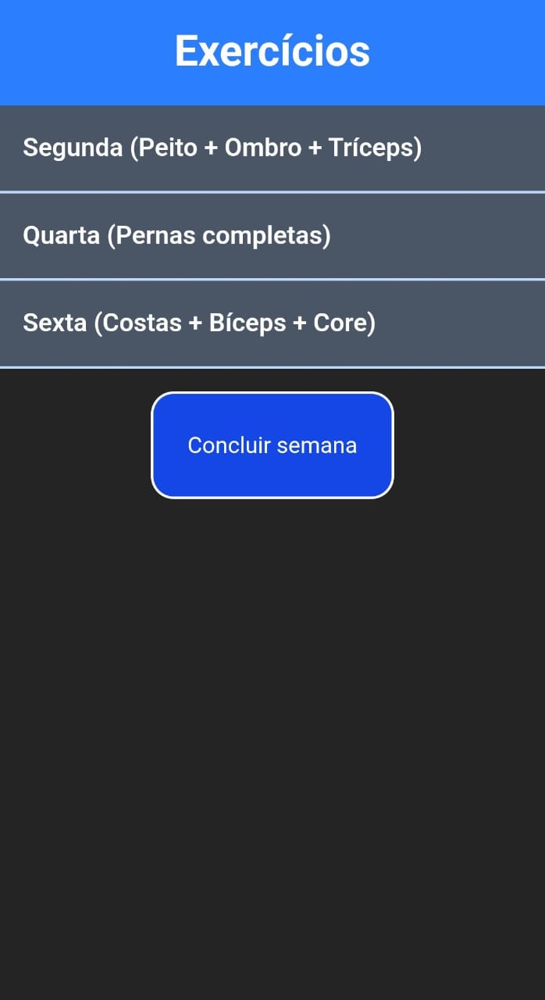
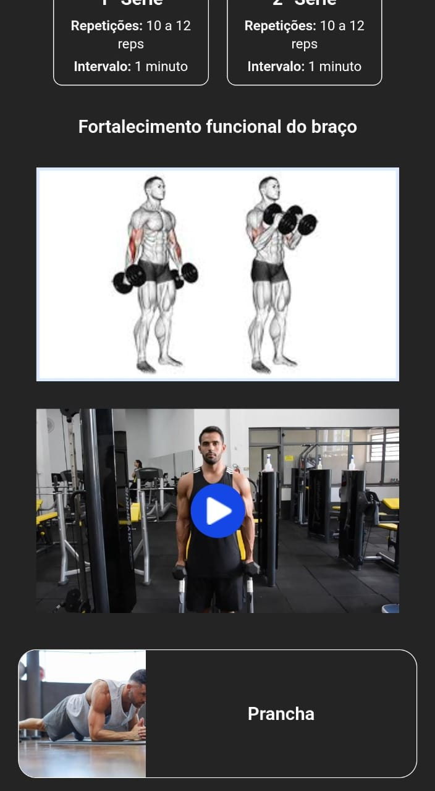
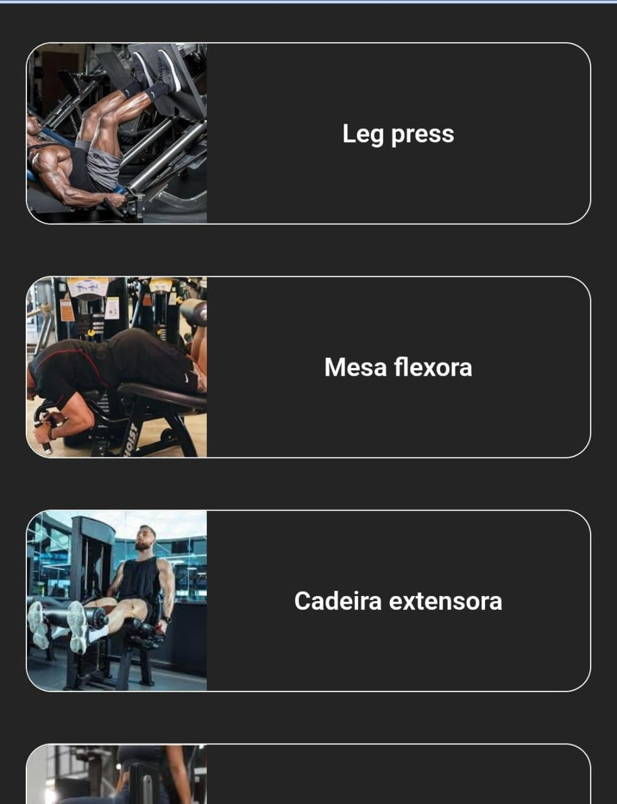
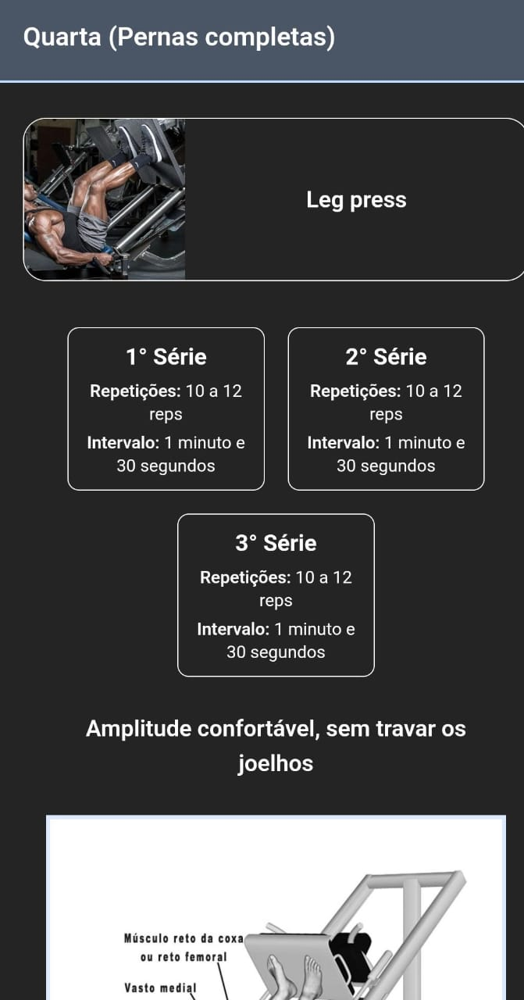

# 🏋️ Treino Diário

Aplicativo web para acompanhar a rotina de treinos da semana, feito para ser usado direto no celular, inclusive como app instalado (PWA).

Este projeto nasceu de uma necessidade real: ajudar meu pai a organizar e acompanhar os exercícios dele na academia. Também foi o meu principal projeto de estudo para aprender **React** na prática.

> 🔗 **Demo:** https://rotina-exercicios-academia.vercel.app/

<p align="center">
  
  
  
  
</p>

## ✨ Funcionalidades

- 📅 **Plano semanal organizado por dia** (Segunda: peito, ombro e tríceps; Quarta: pernas; Sexta: costas, bíceps e core). Dias de descanso não aparecem na lista.
- 📂 **Dias e exercícios expansíveis**: toque no dia para ver os exercícios e toque no exercício para ver os detalhes.
- ✅ **Marcação de séries concluídas**: cada série é um cartão que muda de cor quando concluído. Quando todas as séries estão feitas, o exercício inteiro também fica destacado.
- ⚖️ **Registro de carga por série**: segure (long press de 500 ms) em uma série para abrir um modal e informar o peso, como `10kg` ou `5 placas`.
- 🖼️ **Apoio visual**: foto do exercício, imagem do músculo trabalhado e vídeo de execução com play/pause ao toque.
- 💾 **Progresso salvo no aparelho** com `localStorage`, então nada se perde ao fechar o app.
- 🔄 **Botão "Concluir semana"**: zera as séries marcadas para começar a próxima semana, mantendo as cargas anotadas.
- 📲 **PWA instalável**: pode ser adicionado à tela inicial do celular e abre em tela cheia, com service worker registrado.

## 🛠️ Tecnologias

| Tecnologia | Uso |
| --- | --- |
| [React 19](https://react.dev/) | Interface e gerenciamento de estado |
| [TypeScript](https://www.typescriptlang.org/) | Tipagem estática |
| [Vite 7](https://vite.dev/) | Bundler e servidor de desenvolvimento |
| [Tailwind CSS 4](https://tailwindcss.com/) | Estilização |
| [vite-plugin-pwa](https://vite-pwa-org.netlify.app/) | Manifest e service worker (PWA) |
| [ESLint](https://eslint.org/) | Padronização e qualidade do código |

## 📚 O que eu pratiquei neste projeto

- **Componentização**: `App`, `Day`, `Exercise` e `AddWeightModal`, cada um com uma responsabilidade clara.
- **Props e tipagem com TypeScript**: tipos para dias, exercícios e funções recebidas por props.
- **Hooks**: `useState` (inclusive com inicialização preguiçosa a partir do `localStorage`), `useEffect` para persistir dados e controlar o scroll do `body`, e `useRef` para o timer do long press e para o input do modal.
- **Elevação de estado (lifting state up)**: o estado do plano fica no `App`, e os componentes filhos disparam ações por callbacks.
- **Atualização imutável de estado**: uso de `structuredClone` para alterar séries e cargas sem mutar o estado anterior.
- **Renderização condicional e listas** com `map` e `key`.
- **Eventos de mouse e toque** (`onMouseDown`, `onTouchStart`...) para implementar o long press.
- **Persistência no navegador** com `localStorage`.
- **PWA**: configuração de manifest, ícones e service worker com atualização automática.
- **Design responsivo** com Tailwind, pensando primeiro no celular.

## 🚀 Como rodar o projeto

Pré-requisito: [Node.js](https://nodejs.org/) 20 ou superior.

```bash
# clone o repositório
git clone https://github.com/SEU-USUARIO/rotina-exercicios-academia.git

# entre na pasta
cd rotina-exercicios-academia

# instale as dependências
npm install

# rode em modo de desenvolvimento
npm run dev
```

Abra o endereço mostrado no terminal (normalmente `http://localhost:5173`).

### Outros comandos

```bash
npm run build     # gera a versão de produção na pasta dist
npm run preview   # visualiza localmente o build de produção
npm run lint      # roda o ESLint
```

## 🗂️ Estrutura do projeto

```
.
├── public/
│   ├── imgs/                 # fotos dos exercícios
│   │   └── muscle/           # imagens dos músculos trabalhados
│   ├── videos/               # vídeos de execução
│   └── treino.png            # ícone do PWA
├── src/
│   ├── assets/               # ícones usados na interface
│   ├── App.tsx               # estado global, persistência e layout principal
│   ├── day-component.tsx     # seção de cada dia da semana
│   ├── exercise-component.tsx# cartão do exercício, séries, imagens e vídeo
│   ├── add-weigh-component.tsx # modal para alterar a carga
│   ├── training-plan.ts      # plano de treino (dados iniciais)
│   ├── App.css
│   ├── index.css
│   └── main.tsx              # ponto de entrada e registro do service worker
├── index.html
├── vite.config.ts            # Vite, Tailwind e configuração do PWA
└── package.json
```

## ✏️ Personalizando o plano de treino

Todo o plano fica em `src/training-plan.ts`. Para adicionar ou alterar exercícios, edite esse arquivo seguindo o formato:

```ts
{
  id: "legPress",
  name: "Leg press",
  sets: [false, false, false],   // uma posição por série
  reps: "10 a 12 reps",
  rest: "1 minuto e 30 segundos",
  weight: ["", "", ""],          // uma posição por série
  text: "Amplitude confortável, sem travar os joelhos",
  image: "/imgs/leg-press.jpg",
  muscleImage: "/imgs/muscle/leg-press.jpg",
  video: "/videos/leg-press.mp4" // pode ficar vazio ("")
}
```

> ⚠️ Como o progresso é salvo no `localStorage`, ao mudar o plano pode ser necessário limpar os dados do site no navegador para carregar a nova versão.

## 🔮 Ideias para adicionar
 
- [ ] Histórico de cargas por exercício para acompanhar a evolução
- [ ] Editar o plano de treino pela própria interface
- [ ] Temporizador de descanso entre as séries
- [ ] Testes automatizados

## 👨‍💻 Autor

Feito por **Vinny Daros Trindade** como projeto de aprendizado em React.

- LinkedIn: https://www.linkedin.com/in/vinny-daros-trindade-2b4a70263/
- GitHub: [@vinnydarostrindad](https://github.com/vinnydarostrindad)
